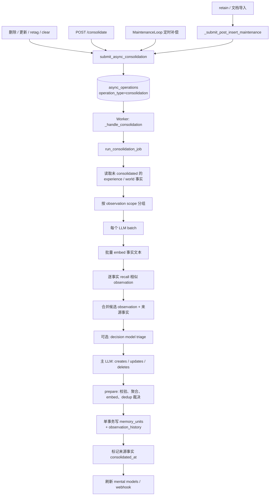

# 文渊 Observation（观察）数据处理流程说明

> 本文描述文渊（WenYuan）中 **observation（观察）** 这种记忆数据从 **触发** → **取数** → **LLM 合成** → **落库** → **检索/失效** 的完整链路。文渊是与参考实现 API 与 PostgreSQL schema 兼容的服务，因此本文描述的行为与参考实现一致。
>
> 核查基线：2026-11-04。

---

## 目录

- [0. 全局视图](#0-全局视图)
- [1. 数据模型：observation 存在哪](#1-数据模型observation-存在哪)
- [2. 触发时机](#2-触发时机)
- [3. 端到端处理流程](#3-端到端处理流程)
- [4. LLM 提示词](#4-llm-提示词)
- [5. 读了哪些表、写了哪些表](#5-读了哪些表写了哪些表)
- [6. Observation 生命周期](#6-observation-生命周期)
- [7. 检索侧如何使用 observation](#7-检索侧如何使用-observation)
- [8. 关键配置默认值](#8-关键配置默认值)
- [9. 常见误解纠正](#9-常见误解纠正)
- [10. 后台任务地图](#10-后台任务地图)

---

## 0. 全局视图

一句话总结：**observation 不是独立表，而是 `memory_units` 中 `fact_type='observation'` 的行**。consolidation 后台任务把 `experience` / `world` 原始事实批量交给 LLM，LLM 返回 `creates / updates / deletes`，再在一个事务里写入 observation、证据数组、时间边界和历史快照。



---

## 1. 数据模型：observation 存在哪

### 1.1 主表 `memory_units`

observation 和原始事实共用一张表，靠 `fact_type` 区分：

| 列 | observation 的取值/含义 |
|---|---|
| `id` | UUID |
| `bank_id` | 所属 bank |
| `document_id` | SQL 存储下通常为 `NULL`，observation 不直接挂文档 |
| `text` | 合成后的观察文本 |
| `embedding` | 观察文本的向量，供语义召回 |
| `fact_type` | `'observation'` |
| `event_date` | 来源事实中最早的 `event_date`；没有则创建时间 |
| `occurred_start` | 来源事实中最早的开始时间 |
| `occurred_end` | 来源事实中最晚的结束时间 |
| `mentioned_at` | 来源事实中最晚的“被提及时间” |
| `proof_count` | 去重后的来源事实数量 |
| `source_memory_ids` | `UUID[]`，支撑该观察的事实 ID 数组 |
| `tags` | 该 observation 所属的 scope 标签 |
| `created_at` / `updated_at` | 创建/最近改写时间 |
| `search_vector` | 全文检索列，随 `text` 更新 |
| `confidence_score` | `NULL`（observation 不需要） |
| `access_count` / `metadata` | 默认值 |

关键点：

- **证据是 `source_memory_ids` 数组**，PG 上直接存在 observation 行里；Oracle 额外走 `observation_sources` 关联表。
- **`proof_count` 是去重后的来源数**，不是简单累加。
- **observation 自己不再参与 consolidation**：取待处理事实时只取 `fact_type IN ('experience','world')`。

### 1.2 历史表 `observation_history`

每次 UPDATE 前写入一条快照：

```json
{
  "previous_text": "...",
  "previous_tags": ["..."],
  "previous_occurred_start": "...",
  "previous_occurred_end": "...",
  "previous_mentioned_at": "...",
  "new_source_memory_ids": ["..."]
}
```

表结构：

```sql
observation_history (
  id BIGINT IDENTITY PRIMARY KEY,
  observation_id UUID NOT NULL,
  bank_id TEXT NOT NULL,
  content JSONB NOT NULL,
  changed_at TIMESTAMPTZ NOT NULL DEFAULT now()
)
```

默认保留最近 **50 条**（`DEFAULT_OBSERVATION_HISTORY_MAX_ENTRIES = 50`），写入后裁剪最旧记录。删除 observation 时会显式删除它的历史。

### 1.3 原始事实上的 consolidation 状态列

`memory_units` 同时保存来源事实，这些列决定“哪些事实还没被观察过”：

| 列 | 作用 |
|---|---|
| `consolidated_at` | 已成功合并进 observation 的时间；`NULL` 表示待处理 |
| `consolidation_failed_at` | LLM 多次失败后被永久标记，避免无限重试 |
| `observation_scopes` | retain 时写入的 JSONB，控制该事实按哪些 tag scope 生成观察 |
| `tags` | 事实自身标签，也是默认 observation scope |

### 1.4 索引

- `idx_memory_units_bank_type_date`：按 bank + fact_type + event_date。
- `idx_memory_units_observation_date`：`WHERE fact_type='observation'` 的部分索引。
- 每 bank 的 HNSW 向量索引（observation 分区单独建）。
- `source_memory_ids` 上的 GIN 索引，用于“哪些 observation 引用了这些事实”。
- `tags` 上的 GIN/数组索引，用于 scope 过滤。

---

## 2. 触发时机

| 触发场景 | 入口 | 条件 |
|---|---|---|
| retain / 文档导入完成后 | 写入后的维护提交 | `enable_observations` 且 `enable_auto_consolidation` |
| 删除文档 | 删除文档路径 | 有 observation 被失效，且 auto 开启 |
| 更新/重新打标签文档 | 更新文档路径 | `invalidated_obs > 0` 或 `requeued_units > 0`，且 auto 开启 |
| 删除单条/批量记忆 | 删除记忆路径 | 有 observation 被失效，且 auto 开启 |
| 删除/清空 bank | 删除 / clear 路径 | 有 observation 被失效，且 auto 开启 |
| 清除某条记忆的 observation | 清除该记忆的 observation | `enable_auto_consolidation` |
| 手动触发 | `POST /v1/default/banks/{bank_id}/consolidate` | `caller_requested=True`，即使 auto 关闭也会跑，并会排空 backlog |
| 定时补偿 | 维护循环里的 consolidation reconcile routine | 扫描有 backlog 的 bank，要求 `enable_observations && enable_auto_consolidation` |
| 单轮达到上限 | job 内部自我重排 | 默认每轮最多 100 条；`caller_requested` 或 auto 开启时继续 |
| 恢复失败任务 | `POST .../consolidation/recover` | 只清 `consolidation_failed_at` 和 `consolidated_at`，不主动提交；下一次运行拾取 |

自动触发统一走异步提交路径，按 bank 去重：已有 pending consolidation 时复用原 `operation_id`。

任务落到 `async_operations`，由 worker 的 consolidation 处理器调用 consolidation job。

---

## 3. 端到端处理流程

### 3.1 任务入口

consolidation job 做三件事：

1. 解析该 bank 的完整配置（bank 级覆盖）。
2. 绑定 trace 上下文，记录本次产生的 observation 和消耗的来源事实。
3. 进入批处理核心循环。

核心循环：

- 若 `enable_observations` 为 false，直接返回 `{"status":"disabled"}`。
- 查询 `banks` 表确认 bank 存在。
- 统计待处理事实数；为 0 则返回 `no_new_memories`。
- 写初始进度到 `async_operations`。

### 3.2 读取待处理事实

读取待处理事实走 memories store 的 `find_unconsolidated()`：

```sql
SELECT ...
FROM memory_units
WHERE bank_id = $1
  AND consolidated_at IS NULL
  AND consolidation_failed_at IS NULL
  AND fact_type = ANY($2)          -- ['experience', 'world']
  [AND tags @> $3::varchar[]]      -- 可选 scope
ORDER BY created_at ASC
LIMIT $n
```

细节：

- **只处理原始事实**，不处理 observation。
- **老事实优先**，保证按到达顺序消化。
- 传了 `observation_scopes` 时，多个 scope 用 `OR` 合并。
- `consolidation_llm_parallelism > 1` 时，会按 consolidation group 做公平切片，避免一个大 group 饿死其他 group。
- 读到的行带 `updated_at`，写事务前会重新校验，防止 LLM 处理期间事实被编辑。

### 3.3 按 observation scope 分组

分组规则决定一条事实写到哪些 scope：

| `observation_scopes` | 行为 |
|---|---|
| `None` / `"combined"`（默认） | 一次 pass，scope = 该事实的全部 `tags` |
| `"per_tag"` | 每个 tag 一次 pass，生成独立 observation |
| `"all_combinations"` | 所有非空 tag 子集各一次 pass |
| `"shared"` | 一次 pass，scope 为 `[[]]`，即全局无标签 scope |
| 显式 `list[list[str]]` | 每个 scope 一次 pass；支持 `topic:*` 这种 glob，按事实自身 tag 展开 |

安全约束：

- **不同 scope 的事实绝不能共享同一次 LLM 调用**，否则会把 A scope 的内容写进 B scope。
- 多 pass 时，`consolidated_at` 只在**最后一个 pass** 的写事务里打标。
- 并行 dispatcher 会按 scope 加锁；重叠 scope 的 group 串行，完全不相交的 group 并行（默认最多 4 个 group）。
- 显式 scope 列表为空时，会回退到默认 combined 单 pass。

### 3.4 单个 LLM batch 的处理

单个 LLM batch 的处理步骤：

#### （1）批量 embed 事实文本

所有事实的 query 向量**一次 embedder 调用**生成，避免每条事实单独 round trip。

#### （2）逐事实 recall 相似 observation

对每条事实调用 recall 取相似 observation：

- `fact_type=["observation"]`
- `budget="low"`（`consolidation_recall_budget` 默认 low）
- `max_tokens=512`（`consolidation_max_tokens` 默认）
- `tags` = 该 scope 的标签，`tags_match="all_strict"`，防止跨租户/跨用户泄漏
- `include_source_facts=True`，并带两个 token 预算：
  - 总来源事实：4096 tokens
  - 每个 observation 的来源事实：256 tokens
- `reranking="interleave"`：不用 cross-encoder/RRF，而是让每个召回臂的 top 结果都进入上下文，避免“语义第一名是近重复观察”被 rerank 埋掉
- `_connection_budget=1`，一个 recall 只占一个连接

召回臂（4-way parallel retrieval）：

| 臂 | 读取 |
|---|---|
| 语义 | `memory_units.embedding`（observation 分区 HNSW） |
| BM25 | `memory_units.search_vector` |
| 图 | `memory_links` + `unit_entities` + `entities` |
| 时序 | `memory_units.event_date` 等时间列 |

`include_source_facts` 会再次读 `memory_units`，按 `source_memory_ids` 取出证据原文。

#### （3）合并候选 observation

同一批次里每条事实各召回一组 observation，按 `id` 去重后合并成一个 union。LLM 看到的候选池就是这个 union。

**召回失败不会降级为“没有相似 observation”**：整批失败并重试，否则会把本应 UPDATE 的写成重复 CREATE。

#### （4）观察数量上限

观察数量上限由 `max_observations_per_scope` 决定（默认 `-1` 无限）：

- 统计当前 scope 下已有 observation 数（`memory_units.tags @> scope`，无标签 observation 不计入）。
- 计算 `remaining_observation_slots`。
- 为 0 时，prompt 里写 `OBSERVATION LIMIT REACHED`，只允许 UPDATE/DELETE。
- 响应里的 `creates` 也会按剩余槽位截断。

#### （5）可选 triage（decision model）

triage（decision model）只有在：

- `consolidation_use_decision_model = true`（默认 true）
- 且服务端配置了 `WENYUAN_API_DECISION_MODEL_*` / `WENYUAN_API_CONSOLIDATION_DECISION_MODEL_*`

时才启用。启用后，对每条事实并行问一组 typed questions：

| 问题 | 选项 |
|---|---|
| `relation` | `restates` / `new` / `changes` / `chatter` |
| `match` | 哪个候选 observation 是同一实体/属性 |
| `covers_oN` | 该候选是否已完整表达新事实 |
| `touches_oN` | 新事实是否让该候选需要改写 |
| `keep_as` | 有 bank mission 时：`as_stated` / `reworded` / `not_wanted` |

判定规则：

- 任一 `touches_oN = yes` 且候选 observation **不比事实旧** → 交给主 LLM 改写。
- `chatter` → 直接丢弃（如果 bank 自定义 mission，则不丢，交给 LLM）。
- `restates` 且 `covers` → 作为证据 UPDATE 到该 observation，文本保持不变。
- `new` 且允许创建 → 直接把事实句子作为新 observation 的文本。
- 同一批次里多条 `new` 涉及同一实体 → 交给主 LLM 合并，避免产生近重复 siblings。

triage 能解决的事实不会进入主 LLM；只有“需要改写现有 observation”的事实才走主 LLM。

#### （6）主 LLM 调用

主 LLM 调用的构造：

- 构造 system prompt（稳定前缀，可缓存）。
- 构造 user message（mission + capacity + 新事实 + 候选 observation）。
- `response_format` 是动态生成的 Pydantic 模型：
  - `creates` 可能被 `maxItems` 限制到剩余槽位。
  - `source_fact_ids` 的 JSON Schema 用 `enum` 限定为本批次事实 ID，防止小模型编造 UUID。
- `strict_schema` 由 `llm_strict_schema_consolidation` 控制。
- `temperature = llm_temperature_consolidation`。
- `scope="consolidation"`，走 consolidation 的并发/限流桶。
- 支持 Gemini 等 provider 的 context cache：system prefix 跨 batch、跨 bank 复用；mission/capacity/facts 放在 user message，避免缓存失效。

#### （7）解析与修正 LLM 响应

- `updates` 的 `observation_id` 如果其实是本批次的事实 ID → 当成 `create`（模型把新事实误写成更新目标）。
- 同一 `observation_id` 出现多条 update → 保留最后一条文本，合并所有 `source_fact_ids`。
- `deletes` 必须带 `observation_id`；缺少会拒绝整个响应（包括同批的 creates/updates）。
- `delete.merged_into` 表示“合并式删除”，证据要转移到幸存 observation。
- 模型抄错 UUID 尾部时，会按前 13 位匹配候选池，唯一命中则修正。

### 3.5 LLM 之后的 prepare 阶段（不持有数据库连接）

这一步把所有慢操作做完，确保写事务里没有 LLM/embedder 调用。

#### （1）delete 校验

- delete 目标必须在本次 recall 候选池里。
- 同一响应里同时 UPDATE 和 DELETE 同一个 observation → **UPDATE 优先**（更新携带更新的知识）。

#### （2）update 校验

- `observation_id` 必须在候选池里，否则拒绝（安全：不能跨 scope 更新）。
- `source_fact_ids` 必须属于本批次事实。
- 预检来源事实是否都已被删除；全删则跳过，不 embed。

#### （3）create 校验

- `source_fact_ids` 必须属于本批次事实。
- **精确文本去重**：如果 create 的文本与已展示给 LLM 的某个 observation 完全一致，或与同一响应里某条 update 的新文本一致，直接丢弃该 create，不插入重复行。
- 预检来源事实存活。

#### （4）来源字段聚合

来源字段聚合规则：

| 字段 | 规则 |
|---|---|
| `event_date` | 来源最小值 |
| `occurred_start` | 来源最小值 |
| `occurred_end` | 来源最大值 |
| `mentioned_at` | 来源最大值 |
| `tags` | 默认取来源事实的 tags；显式 scope 时用 scope tags |

缺失值保持 `None`，不会伪造时间。

#### （5）批量 embed observation 文本

把所有 update/create 的新文本去重后一次 embed，结果按文本缓存成 pgvector literal。

#### （6）语义去重裁决（默认开启）

语义去重裁决（默认开启）：

- 阈值 `consolidation_dedup_threshold = 0.97`（余弦相似度）。
- CREATE 和 UPDATE 都会做。
- 用 observation 文本做 anchor（不是原始事实），在**同 tag scope** 内做 dense + BM25 检索，`enable_graph=False`、无时间窗。
- 取最相似且 ≥ 阈值的 observation。
- 让 LLM 做一次 1 对 1 裁决：`merge` 或 `keep`。
- `merge` 时生成合并文本，后续把新 observation 折叠进旧 observation，而不是插入。
- **仅 PostgreSQL 启用**；Oracle 上自动跳过（merge SQL 用了 PG-only 的 `unnest`/`array_agg`/`UPDATE ... FROM`）。

### 3.6 单事务写库

所有写入在一个事务里完成：

1. **锁写入集合**：按 retain 的加锁顺序锁 documents → memories，再锁相关 observation，避免死锁。
2. **重新校验来源事实**：比较 `updated_at`；有变化就**丢弃整个响应**（包括 `consolidated_at` 标记），下次重新读。
3. **执行 DELETE**：
   - 删除 `memory_units` 中该 observation 行。
   - 删除 `observation_history` 中它的历史。
   - 如果是 merge 式删除，先把它的来源事实和时间边界折到幸存 observation。
4. **执行 UPDATE**：
   - 重写 `text`、`embedding`、`search_vector`。
   - `source_memory_ids` 与旧数组合并去重。
   - `proof_count = len(unique source ids)`。
   - `tags` 与来源事实的 tags 取并集。
   - 时间边界只扩不缩：`event_date/occurred_start` 取 min，`occurred_end/mentioned_at` 取 max。
   - `updated_at = now()`。
   - 若 `enable_observation_history`，写入一条 `observation_history` 快照并按 50 条裁剪。
   - Oracle 同步 `observation_sources` 关联表。
5. **执行 CREATE**：
   - 再次 `FOR SHARE` 校验来源事实存活。
   - 插入 `memory_units`，`fact_type='observation'`，`proof_count=来源数`，`source_memory_ids` 去重。
   - `event_date` 默认 now，`mentioned_at` 默认 now。
6. **执行 dedup fold**：
   - CREATE 折叠：把新来源并进已有 twin，跳过插入。
   - UPDATE 折叠：把更新后的 observation 并进 twin，删除原行。
7. **标记来源事实**：
   - 成功处理的来源事实写 `consolidated_at = now()`。
   - 失败的来源事实在事务外写 `consolidation_failed_at`。
   - 标记与 observation 写入在**同一事务**，避免“观察没写成但事实已标记，永远不会再处理”。

### 3.7 失败、重试、分批

- 主 LLM 调用默认最多 **3 次**（`consolidation_max_attempts`）。
- 失败分类：
  - `PROPAGATE`：非批次错误，向上抛给 worker 重试。
  - `FAIL_FAST`：不可重试（如 schema 明确不兼容），不重发相同 payload。
  - 其他：指数退避 1s → 8s。
- 整个 sub-batch 仍失败 → **二分拆批**，一直拆到单条事实。
- 单条事实仍失败 → 写 `consolidation_failed_at`，不再无限重试。
- LLM 响应漏掉的事实 → 用更小批次重新问，最多再问 2 次；单独一条仍被漏掉则视为 `no_durable_knowledge`。
- 整个响应 schema 校验失败 → 丢弃该响应（包括其中的 deletes），由二分重试兜底。

### 3.8 结束阶段

- 每完成一个 LLM batch 就写 `async_operations` 进度：processed/total、created/updated/merged/deleted、failed。
- 达到 `consolidation_max_memories_per_round`（默认 100）→ 自我重新提交，继续排空 backlog。
- 最终轮结束后触发 **mental model refresh**：只刷新 scope 覆盖本次 consolidated tags 的 mental model，每个 model 最多一次。
- worker 标记 operation 完成，并触发 webhook。

---

## 4. LLM 提示词

### 4.1 主 consolidation system prompt

位置：consolidation 的 prompt 构造（`build_consolidation_system_prompt`）。

结构：

```text
You are a memory consolidation system. Synthesize new facts into
observations, merging with existing observations when appropriate.

If anything in this MISSION conflicts with the PROCESSING RULES,
DECISION GUIDE, or OUTPUT FORMAT below, the MISSION takes priority.

## LANGUAGE
Write every observation in the language of its own source facts — never translate them.
Per observation, not per batch: when one merges facts of several languages, the majority wins.
When an existing observation is written in a different language from the new facts updating it,
do NOT edit its wording in place — compose the merged observation from scratch in the new facts' language.

## PROCESSING RULES
1. PREFER UPDATE OVER CREATE ...
2. ONE OBSERVATION PER DISTINCT FACET ...
3. MATCH BY ENTITY/FACET, NOT TOPIC ...
4. STATE CHANGES — UPDATE CONCISELY ...
5. CASCADE TO ALL AFFECTED OBSERVATIONS ...
6. RESOLVE REFERENCES ...
7. PRESERVE HISTORY ...
8. NO COMPUTATION ...
9. KEEP DISTINCT TOPICS DISTINCT ...
10. RECENCY IS `mentioned_at`, NOT ARRIVAL ORDER ...
11. SKIP EPHEMERAL CHATTER ...
12. AN UPDATE REPLACES THE WHOLE TEXT ...

## INPUT FORMAT
### New facts
One per line, formatted as `[uuid] fact text (temporal fields)`:
- `[uuid]`: copy verbatim into `source_fact_ids`
- `occurred_start` / `occurred_end`: when the event happened
- `mentioned_at`: when the source material was written — the fact's recency,
  NOT when it was added to memory

### Existing observations
A JSON array pooled from recalls across the new facts. Each entry has:
- `id`, `text`, `proof_count`
- `occurred_start` / `occurred_end`
- `mentioned_at`
- `source_memories`: supporting facts, each with `text`, optional `context`, and temporal fields

## DECISION GUIDE
- Same canonical event/decision/claim/facet as an existing observation → UPDATE
- New durable knowledge with no existing match → CREATE
- Cross-reference facts within the batch
- Purely ephemeral facts → omit unless MISSION targets them

## OUTPUT FORMAT
Return a JSON object with three arrays: `creates`, `updates`, `deletes`.
Every entry must include a `reason`.
... 3 个完整示例 ...
```

12 条规则的要点：

| # | 规则 |
|---|---|
| 1 | 有可合并对象时优先 UPDATE；候选池为空或没有同 facet 时才 CREATE |
| 2 | 一个 observation 只跟踪一个 facet（一个计数、一个实体、一个关系、一个决策） |
| 3 | 按实体/facet 匹配，不按宽泛主题匹配 |
| 4 | 状态变化要简洁地更新对应 facet，不带入其他 observation 的信息 |
| 5 | 状态变化可能级联影响多个 observation（如从列表移除成员） |
| 6 | 新事实给出具体值时，把模糊占位符解析进 observation |
| 7 | 记录重大事件的 observation 是历史，不要删除；只有完全重复或无意义才删 |
| 8 | 不做算术/逻辑推导；计数只在用户明确给出新计数时更新 |
| 9 | 不同人物/实体/主题不合并；名字差一个字母也算不同实体 |
| 10 | 用 `mentioned_at` 判断新旧，不是到达顺序；更早的事实只能作为“早期状态”加入 |
| 11 | 跳过寒暄、瞬时活动、屏幕内容等 ephemeral chatter |
| 12 | UPDATE 的 `text` 必须仍表达旧 observation 的全部内容，只改被新事实改变的部分 |

### 4.2 主 consolidation user message

位置：consolidation 的输入构造（`build_consolidation_input`）。

```text
## MISSION

{observations_mission or 默认 mission}

## CAPACITY CONSTRAINT        (可选)

{OBSERVATION LIMIT REACHED (N/N). Only UPDATE or DELETE...}
或
{This scope has K observation slot(s) remaining (out of N). Prefer UPDATE over CREATE...}

## INPUT

### New facts

[<uuid>] <fact text> (occurred_start=..., occurred_end=..., mentioned_at=...)
[<uuid>] ...

### Existing observations

[
  {"id": "...", "text": "...", "proof_count": 2,
   "occurred_start": "...", "occurred_end": "...", "mentioned_at": "...",
   "source_memories": [{"text": "...", "context": "...", ...}]}
]
```

默认 mission：

> Track anything notable in the new facts — names, numbers, dates, places, events, decisions, claims, relationships, and recurring patterns.

bank 可以设置 `observations_mission` 完全替换这段文本，从而控制“什么算值得观察的知识”。

### 4.3 输出 JSON 结构

```json
{
  "creates": [
    {
      "text": "观察文本",
      "source_fact_ids": ["本批次事实 UUID"],
      "reason": "为什么 CREATE，而不是 UPDATE"
    }
  ],
  "updates": [
    {
      "observation_id": "已有 observation UUID",
      "current_text": "更新前文本（可选，用于让模型先复制再编辑）",
      "text": "更新后文本",
      "source_fact_ids": ["本批次事实 UUID"],
      "reason": "为什么 UPDATE"
    }
  ],
  "deletes": [
    {
      "observation_id": "要删除的 observation UUID",
      "merged_into": "合并到哪个 observation UUID（可选）",
      "reason": "为什么删除"
    }
  ]
}
```

关键约束：

- `source_fact_ids` 必须是本批次事实 ID；JSON Schema 用 `enum` 限定。
- 同一个 `observation_id` 最多一条 update；多条会被合并，保留最后文本。
- delete 必须带 `observation_id`；缺失会拒绝整个响应。
- merge 式删除带 `merged_into`，证据会转移到幸存 observation；普通删除则是“retire”一个信念。
- `reason` 每条必填，用于审计“为什么创建/更新/删除”。

### 4.4 triage 的 decision-model 提示

位置：triage 的 typed questions（`triage_facts`）。

它不是自由文本 prompt，而是一组 typed questions。问题文本：

```text
How does `new_fact` relate to `existing_observations`?
  restates / new / changes / chatter

Which existing observation is about the same entity and attribute as `new_fact`?
  o0 / o1 / ...

Does `existing_observations.oN` already say what `new_fact` says, even in other words?
  yes / no

Knowing `new_fact`, should `existing_observations.oN` now be worded differently or more precisely?
  yes / no

(有 bank mission 时)
`mission` says what this memory keeps and how it words what it keeps.
How should the knowledge in `new_fact` be kept?
  as_stated / reworded / not_wanted
```

裁决逻辑：

- `touches_oN = yes` 且 observation 的 `mentioned_at` 不晚于事实 → 不交给 triage，交给主 LLM。
- `chatter` → 丢弃（除非有自定义 mission）。
- `restates` + `covers` → 作为证据附加，文本不变。
- `new` + 允许创建 → 直接以事实句子创建 observation。
- `new` 但同批次同实体出现多次 → 交给主 LLM 合并。

### 4.5 dedup 的 merge-or-keep 提示

位置：dedup 的 merge-or-keep prompt。

```text
You reconcile long-term memory observations. A NEW observation is about to be
stored, and it is highly similar to an EXISTING one:

[NEW] {new}
[EXISTING] {existing}

Respond with ONLY one valid JSON object matching one of these shapes:

For duplicate facts:
{"action": "merge", "text": "...", "reason": "..."}

For distinct facts:
{"action": "keep", "text": "", "reason": "..."}

Do NOT use key=value lines, markdown fences, or any text outside the JSON object.

If they assert the SAME fact (wording aside), set "action" to "merge" and provide
"text": a single observation that preserves EVERY detail from both. If they differ
in ANY important detail — a number/quantity, a named entity or language, a negation,
or a condition — set "action" to "keep" and "text" to an empty string.
```

---

## 5. 读了哪些表、写了哪些表

### 5.1 读取

| 阶段 | 表 | 条件/用途 |
|---|---|---|
| job 启动 | `banks` | `WHERE bank_id=$1`，确认 bank 存在 |
| 取待处理事实 | `memory_units` | `fact_type IN ('experience','world')`，`consolidated_at IS NULL`，`consolidation_failed_at IS NULL`，可选 `tags @> scope`，`ORDER BY created_at` |
| 相似 observation 召回 | `memory_units` | `fact_type='observation'`；语义用 `embedding`，BM25 用 `search_vector`，时序用 `event_date` |
| 图召回臂 | `memory_links` | 从召回 seed 扩展关联 observation/事实 |
| 图召回臂 | `unit_entities` + `entities` | 实体共现扩展 |
| 来源事实展开 | `memory_units` | 按 `source_memory_ids` 取证据原文，受 4096/256 token 预算限制 |
| triage | `unit_entities` JOIN `entities` | 取每条事实的实体；observation 没有直接实体时继承来源事实的实体 |
| 语义去重 | `memory_units` | `fact_type='observation'`，dense + BM25，同 tag scope，`enable_graph=False` |
| 删除/失效 | `memory_units` | 用 `source_memory_ids && deleted_ids` 找受影响的 observation |
| 删除/失效 | `observation_sources` | Oracle 上用关联表找受影响 observation |
| 进度/结果 | `async_operations` | 读写 `processed/total`、状态、结果、webhook |

### 5.2 写入

| 动作 | 表 | 变化 |
|---|---|---|
| CREATE observation | `memory_units` | 插入 `fact_type='observation'`，写 `text/embedding/proof_count/source_memory_ids/tags/时间列/search_vector` |
| UPDATE observation | `memory_units` | 重写 `text/embedding`，合并 `source_memory_ids`、`tags`，扩宽时间边界，`updated_at=now()` |
| UPDATE history | `observation_history` | 插入更新前快照，裁剪到最近 50 条 |
| DELETE observation | `memory_units` | 删除行 |
| DELETE history | `observation_history` | 按 `observation_id` 删除 |
| Oracle 关联 | `observation_sources` | 插入/删除 `(observation_id, source_id)` |
| 标记来源事实 | `memory_units` | `consolidated_at=now()` 或 `consolidation_failed_at=now()` |
| 进度 | `async_operations` | 更新阶段、processed/total、统计 |

---

## 6. Observation 生命周期

### 6.1 创建

- 由 LLM `create`、triage `new`、或 dedup 未命中产生。
- 文本是新合成的，不是原始事实的简单复制（triage `new` 例外：按事实原句创建）。
- 证据是 `source_memory_ids`，`proof_count` 是去重后的来源数。

### 6.2 更新

- 同 facet 的新事实到达 → UPDATE。
- 文本整体替换，但必须保留旧文本中未被改变的内容。
- 来源事实合并，时间边界扩宽，tags 取并集。
- 历史快照写入 `observation_history`。

### 6.3 合并

- dedup 裁决 `merge` → 新 observation 折叠进旧 twin。
- LLM `delete` 带 `merged_into` → 被删除 observation 的证据转移到幸存者。
- 两个 observation 的 `source_memory_ids` 取并集，`proof_count` 重算，时间边界取并集。

### 6.4 删除

- LLM 判断被直接取代/矛盾 → 普通 delete，证据不转移。
- 删除时同步删除 `observation_history`。
- 删除后，幸存来源事实会被重新排队（`consolidated_at = NULL`），下一次 consolidation 重新生成观察。

### 6.5 来源事实被删除/修改时

删除来源事实时的处理：

1. 找出所有 `source_memory_ids` 与删除事实有交集的 observation。
2. 删除这些 observation 及其历史。
3. 把**幸存的其他来源事实** `consolidated_at` 清空，让它们重新参与 consolidation。
4. 下一个 consolidation 用剩余事实重建观察。

### 6.6 重新打标签/改变 scope

- 文档或记忆的 `tags` / `observation_scopes` 变化时，重新计算它属于哪个 scope，判断是否真的移动到不同 scope。
- 只有真的移动了，才删除旧观察并重新排队来源事实；scope 没变则什么都不做。
- 重新打标签会触发一次 consolidation。

### 6.7 清空

- `DELETE /banks/{bank_id}/memories/{memory_id}/observations`：只清某条记忆派生的 observation，记忆本身保留，重置它和共同来源的 `consolidated_at`，并提交 consolidation。
- 删除整个 bank 的 observation 的维护入口：删除该 bank 全部 observation，重置所有 `experience/world` 事实的 `consolidated_at`。
- 删除 bank：observation 随 `memory_units` 一起删除。

### 6.8 失败恢复

- `POST /banks/{bank_id}/consolidation/recover` 清掉失败标记并重排。
- 只清 `consolidation_failed_at` 和 `consolidated_at`，不主动提交任务。
- 下一次 consolidate（自动或手动）会重新拾取这些事实。

---

## 7. 检索侧如何使用 observation

- `recall()` 默认会把 observation 和原始事实一起返回；`types` / `prefer_observations` 控制偏好。
- `reflect` 的 `search_observations` 工具：
  - 只召回 `fact_type='observation'`。
  - 返回 `source_facts` 作为证据。
  - 返回 freshness：
    - `pending_consolidation = 0` → `up_to_date`
    - `< 10` → `slightly_stale`
    - `>= 10` → `stale`
  - `is_stale = pending_consolidation > 0`
  - agent 看到 stale 时，应再用 `recall()` 验证原始事实，而不是只信 observation。

---

## 8. 关键配置默认值

| 配置 | 默认值 | 作用 |
|---|---|---|
| `enable_observations` | `true` | 是否启用 observation 生产/检索 |
| `enable_auto_consolidation` | `true` | 写操作后是否自动提交 consolidation |
| `consolidation_batch_size` | `50` | 每次从 DB 取多少条待处理事实 |
| `consolidation_llm_batch_size` | `8` | 每次 LLM 调用放多少条事实 |
| `consolidation_llm_parallelism` | `4` | 同时处理多少个 tag group |
| `consolidation_max_memories_per_round` | `100` | 单轮最多处理多少条，超过则自我重排 |
| `consolidation_max_tokens` | `512` | 召回相似 observation 的 token 预算 |
| `consolidation_recall_budget` | `low` | 召回预算档位 |
| `consolidation_source_facts_max_tokens` | `4096` | 召回时来源事实总预算 |
| `consolidation_source_facts_max_tokens_per_observation` | `256` | 每个 observation 的来源事实预算 |
| `consolidation_max_attempts` | `3` | 单批 LLM 外层重试次数 |
| `consolidation_dedup_threshold` | `0.97` | 余弦相似度 ≥ 此值才做 merge-or-keep 裁决；`1.0` 关闭 |
| `max_observations_per_scope` | `-1` | 每个 scope 的 observation 上限；`-1` 无限 |
| `enable_observation_history` | `true` | 是否记录 UPDATE 前快照 |
| `observation_history_max_entries` | `50` | 每个 observation 保留多少条历史 |
| `consolidation_use_decision_model` | `true` | 是否启用 triage；仍需配置 decision model 才生效 |
| `observations_mission` | `None` | 自定义“什么算值得观察的知识” |

---

## 9. 常见误解纠正

1. **“observation 是独立表/独立 JSON 文档。”**
   不是。SQL 存储下它就是 `memory_units` 的一行，`fact_type='observation'`；证据是行内的 `source_memory_ids` 数组。

2. **“observation 自己也会被继续 consolidate。”**
   不会。取待处理事实的 `fact_type` 只有 `experience` / `world`，observation 不进入该队列。

3. **“`consolidated_at` 打在 observation 上。”**
   不是。`consolidated_at` / `consolidation_failed_at` 是**来源事实**的标记，observation 没有这两个状态的语义。

4. **“`proof_count` 是被召回/访问的次数。”**
   不是。它是去重后的来源事实数量；重算发生在 INSERT/UPDATE/dedup fold。

5. **“每次 retain 都同步跑 consolidation。”**
   不是。retain 只负责入队 `async_operations`；实际执行在 worker，consolidation 是异步任务。

6. **“关掉 auto consolidation 就完全不会跑。”**
   不是。手动 `POST /consolidate` 以 `caller_requested=True` 提交，即使 auto 关闭也会执行并排空 backlog；自动链路才受 `enable_auto_consolidation` 限制。

7. **“LLM 能看到 bank 里所有 observation。”**
   不是。它只看每条事实 recall 回来的候选 union，受 `max_tokens=512`、tag scope、`all_strict` 匹配限制。

8. **“删除来源事实只删 observation 行。”**
   不完整。删除时还会把**幸存的其他来源事实**重新排队（清 `consolidated_at`），让下一次 consolidation 重建观察。

9. **“dedup 对所有数据库都生效。”**
   不是。默认阈值 0.97 开启，但仅 PostgreSQL；Oracle 上因 merge SQL 不兼容而跳过。

10. **“observation 的 tags 一定等于来源事实的 tags。”**
    不一定。默认 scope 是事实 tags；`per_tag` / `all_combinations` / `shared` / 显式列表会改变写入 scope。UPDATE 时还会把新来源事实的 tags 并进已有 observation tags。

---

## 10. 后台任务地图

| 职责 | 所在子系统 |
|---|---|
| 主流程、批处理、prepare/apply、dedup 裁决 | consolidation 引擎 |
| 主 prompt、mission、输出格式 | consolidation prompt 构造 |
| decision-model triage | consolidation triage |
| 读取待处理事实 | memories store 的读取侧 |
| observation 的 INSERT/UPDATE/DELETE | memories store 的 consolidation 写入 |
| 来源删除导致的 observation 失效与重排 | memories store 的写入侧 |
| 清空 observation / 失败重排 | memories store 的 curation |
| 触发入口、异步提交、worker 执行 | 引擎入口与 worker |
| HTTP 接口 | HTTP 路由层 |
| 定时补偿 | 维护循环 |
| reflect 的 observation 检索与 freshness | reflect 工具层 |
| 用户文档 | 开发者文档 observations 页 |
