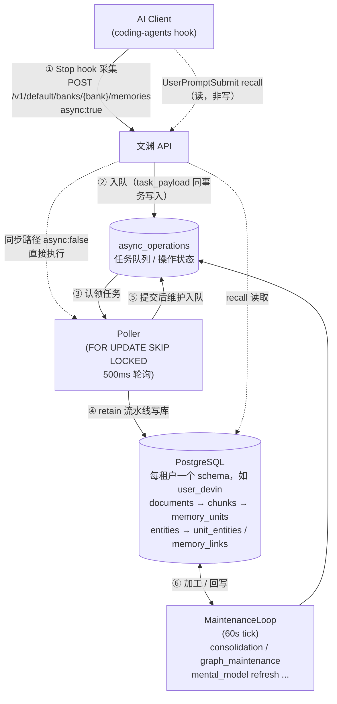
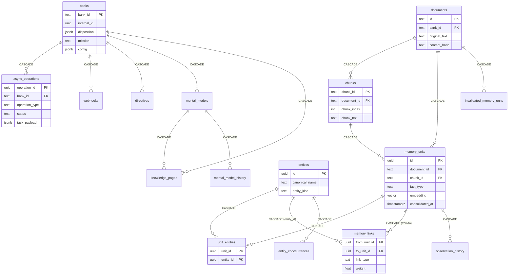
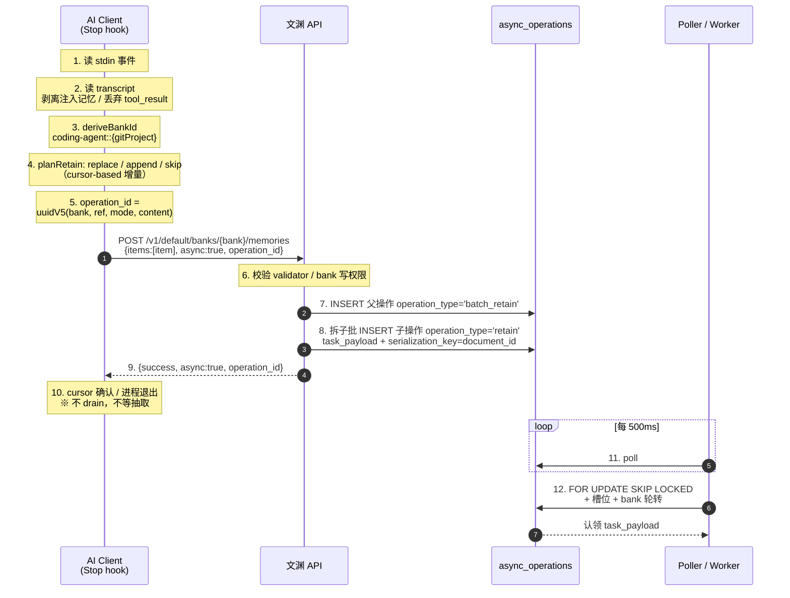
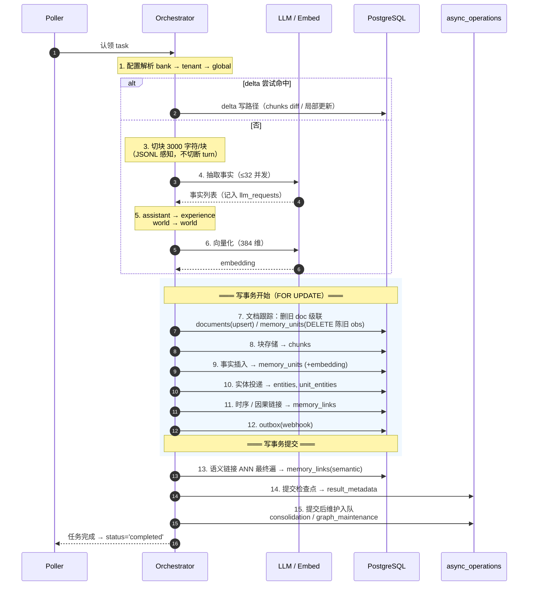
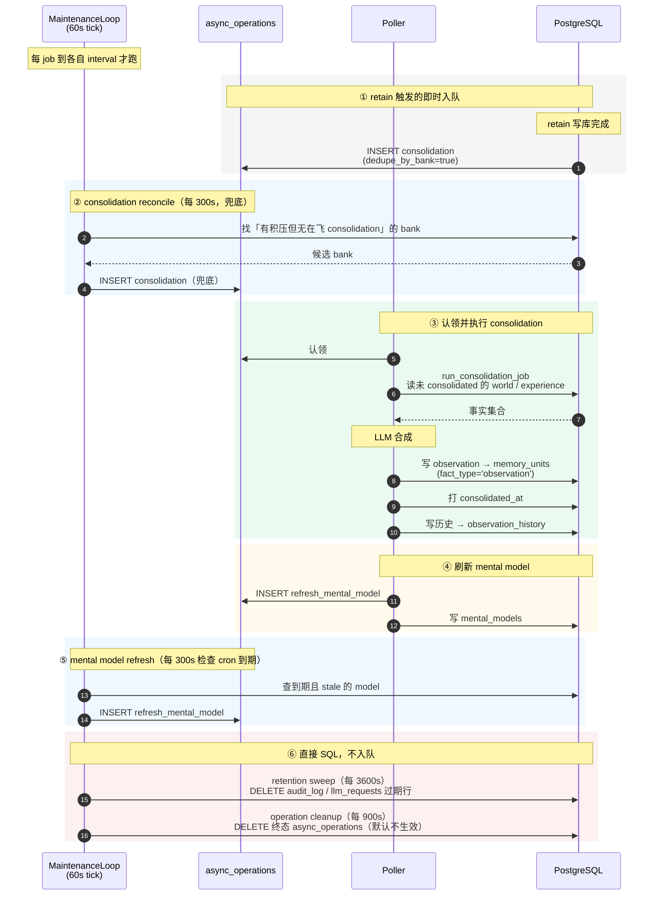

# 文渊用户数据处理流程说明

> 文渊是参考实现（reference implementation）的兼容移植：API、PostgreSQL schema 与数据处理链路一致。本文基于对参考实现仓库源码的逐行核查（file:line 均已标注，除特别注明文渊路径外均指参考实现源码），描述一条用户数据从 **AI 客户端采集** → **文渊 retain 处理** → **落库到具体表** → **后台/定时任务加工** 的完整链路。
>
> 核查中存在若干「常见误解」，已在 [§8 常见误解纠正](#8-常见误解纠正) 集中列出，本文正文均采用**代码事实**而非惯例说法。

---

## 0. 全局视图



---

## 1. 客户端侧：数据如何被采集

### 1.1 只有三个阶段钩子

`HookLifecycle` 的类型定义就是三值，**结构上不存在第四个阶段**：
`sessionStart | prompt | stop`（`coding-agents/src/harness/hook-lifecycle.ts:41`）。

Claude Code 的实际注册（`hook-lifecycle.ts:290-294`）：

| HookLifecycle | 宿主事件 | 入口 | 超时 |
|---|---|---|---|
| sessionStart | `SessionStart` | `claude-sessionstart-hook.js` | 30s |
| prompt | `UserPromptSubmit` | `claude-hook.js` | 30s |
| stop | `Stop` | `claude-stop-hook.js` | 60s |

- **SessionStart** —— 不采集会话内容。做 git 历史播种（冷 bank）+ 注入 knowledge 前言，顺带写一个 `document_id = survey-baseline:<sha>` 的极小标记文档，且是 fire-and-forget（`src/core/session-start.ts:200-221`）。
- **UserPromptSubmit** —— **只读，不写入**。这一侧是 recall / reflect / knowledge pages 的注入半侧（`src/core/hook.ts`）。
- **Stop** —— **唯一的会话写入点**（`src/core/retain-hook.ts:180-270`）。

### 1.2 Stop hook 采集什么

transcript 解析器 `src/core/transcript.ts:80-118`：

- 只保留 `type` 为 `user` / `assistant` 的行（`:97`）。
- **丢弃**：`isMeta`、`isSidechain`（子代理）、`isCompactSummary`（`:98-105`）。
- 文本块合并为一条 prose turn；每个 `tool_use` 压成一条紧凑的 `role:"action"` turn，形如 `Edit boltons/strutils.py` —— **只有工具名 + 主目标，不含参数与输出**（`:47-48`）。
- `tool_result` 块整块丢弃（`:71`）。
- 注入的记忆（`<wenyuan_memories>` 等）被剥离，防止 retain→recall 回环（`:15-17`）。

> ⚠️ **Stop hook 不采集 diff**。完整 diff 走**另一条独立通道**：git 历史播种
> （`src/core/git.ts:87-117`，`document_id = git:<sha>`，`strategy = "git"`，`content` 含完整未截断 diff）。

### 1.3 内容如何渲染：JSONL

`writeSession`（`src/core/chat.ts:313-466`）→ `renderSessionJsonl`（`chat.ts:39-43`）：

- 首行一条合成的 `role:"system"` turn：`REF-ID: conversation:<sessionId>`（`chat.ts:28-30`）。
- 其后每行一个 turn 的 JSON。
- 选 JSONL 的原因（`chat.ts:33-38`）：append 时无需重写整篇；且**服务端结构化 chunker 把每行当原子单元**（`retain_structured_chunk_size`），turn 不会被从中间切断。

### 1.4 请求端点与 payload

**真实端点：`POST /v1/default/banks/{bank_id}/memories`**（参考实现客户端的请求构造处 :526；
服务端 `api/http.py:10318-10319`）。

> 注：`/memories/retain` 只是控制面 Next.js 的**代理路由名**，不是数据面端点。

顶层字段（参考实现客户端的请求构造处 :524-526）：

| 字段 | 值 |
|---|---|
| `items` | `[item]` 单元素数组 |
| `async` | **恒为 `true`（硬编码）** |
| `operation_id` | `uuidV5(bank + refId + mode + content)` —— 确定性，用于重投幂等 |

item 字段（`chat.ts:371-393`）：

| 字段 | 值 |
|---|---|
| `content` | JSONL transcript（replace=全文 / append=增量 turn） |
| `document_id` | `conversation:<sessionId>` |
| `context` | 配置值，否则 `DEFAULT_RETAIN_CONTEXT` |
| `tags` | `[...配置 tags, "source:chat", "harness:<id>"]` |
| `metadata` | `{...配置, source:"chat", session_id, ref_id, harness}` |
| `strategy` | `"conversation"` |
| `timestamp` | transcript 首 turn 的时间戳 |
| `update_mode` | append 时 `"append"`，否则省略（=replace） |

`metadata.harness` 是控制面解析 logo 的**权威字段**，`harness:<id>` tag 是同一值的镜像。
内置值总是覆盖用户配置（`chat.ts:388`），且 `source:` / `harness:` 前缀被保留（`retain-stamp.ts:32`）。

### 1.5 bank_id 推导

`src/core/bank.ts:300-325`（`deriveBankId`），优先级：

1. `mapPathToBank` 路径映射（最长前缀匹配）
2. 静态 `config.bankId`（未设 `dynamicBankId`）
3. 动态模板，默认 **`coding-agent::{gitProject}`**（`bank.ts:53`）

默认模板刻意**不含** `{harness}` —— 一个 repo 一个 bank，所有 agent 共享记忆（`bank.ts:49-52`）。
仓库无法识别时**整个写入被跳过**（`bank.ts:377-394`），避免污染服务器。

### 1.6 客户端去重与重试

- **cursor-based 增量 append**（`src/core/retain-cursor.ts`）：`replace` / `append` / `skip` 三态；pending 缓冲上限 12h / 256 KiB。
- **服务端去重**：确定性 `operation_id`，相同字节重投被折叠进原 operation。
- **重试**：仅 429，最多 2 次，严格尊重 `Retry-After`（`chat.ts:190-209`）。
- **Stop hook 的等待语义**：同步 `await` HTTP 请求，但**只等到「入队确认」，不等抽取完成**。
  `drain()` 在 Stop 路径上**从未被调用**（唯一调用点是 deepen 引擎 `src/deepen.ts:287`）。

---

## 2. 服务端：retain 入口

`POST /v1/default/banks/{bank_id}/memories` → `api_retain`（`api/http.py:10344`）

```
api_retain
  ├─ 规范化 content（canonicalize_item_content）        http.py:10386
  ├─ 落附件（图片 → 内容寻址存储）                      http.py:10411 → retain/attachment_store.py:300
  ├─ 按 strategy 分组                                    http.py:10416-10467
  ├─ async=true  → submit_async_retain()                http.py:10479 → memory_engine.py:23239
  └─ async=false → retain_batch_async()（同步执行）      http.py:10523 → memory_engine.py:6843
```

**异步路径**（客户端实际使用）：

1. 校验（operation validator、bank 写权限）—— `memory_engine.py:23263-23291`
2. 插入父操作行 `operation_type='batch_retain'` —— `memory_engine.py:23430`
3. 按 `retain_batch_chars` 阈值拆子批，每批插一行 `operation_type='retain'`，
   **同时写入 `task_payload` 与 `serialization_key=document_id`** —— `memory_engine.py:23491`
4. 立即返回 `{success, bank_id, items_count, async:true, operation_id}`

> **关键点**：`task_payload` 在**创建行时**就一并 INSERT（`memory_engine.py:23149-23165`），
> 避免出现 `task_payload IS NULL` 的不可认领窗口。

**同步路径**：无 operation 行、无 document event；在 `run_task_cancellable_on_disconnect` 内执行（`http.py:10547`）。

---

## 3. retain 流水线（按执行顺序）

编排入口：`engine/retain/orchestrator.py:1493` `retain_batch`。

| # | 阶段 | 位置 | 写入表 |
|---|---|---|---|
| 0 | 附件提交（图片内容寻址） | `retain/attachment_store.py:300` | `attachments` |
| 1 | 入口清洗（NUL / 代理字符）+ 校验 | `memory_engine.py:6971-7002` | — |
| 2 | 配置解析（bank → tenant → global）+ strategy + LLM 绑定 | `memory_engine.py:7952-7971` | — |
| 3 | 分组、memory-defense 筛查 | `orchestrator.py:1554, 1707` | — |
| 4 | document_id 解析 + append 前置正文读取 | `orchestrator.py:1788-1919` | 读 `documents` |
| 5 | 陈旧请求检查 | `orchestrator.py:1933` | — |
| 6 | **delta 尝试**（见 §3.2） | `orchestrator.py:2003` | 见 §3.2 |
| 7 | **切块** `retain_chunk_size`=3000 字符；JSONL 感知 `retain_structured_chunk_size` | `orchestrator.py:2060-2065` → `fact_extraction.iter_chunks:775` | — |
| 8 | 批控 `retain_chunk_batch_size`=100 / `retain_memory_budget_mb`=128 | `orchestrator.py:2042, 2772` | — |
| 9 | **事实抽取**（LLM，每块一条，≤32 并发） | `orchestrator.py:2829-2899` → `fact_extraction.extract_facts_from_contents:3510` | LLM 调用记入 `llm_requests` |
| 10 | 类型映射：LLM 输出 `assistant` → **`experience`**，`world` → **`world`** | `fact_extraction.py:2252-2260` | — |
| 11 | **向量化**（事实文本 + 可读日期 + 实体名） | `orchestrator.py:1402-1404` → `embedding_processing.py:47` | — |
| 12 | **文档跟踪**（首个批次，写事务内 `FOR UPDATE`）：清理陈旧 observation、删除旧文档级联、upsert 文档行 | `orchestrator.py:3327-3371` → `fact_storage.py:324/358` | `documents`、`memory_units`(DELETE stale obs)、`observation_history`、两个 maintenance 队列 |
| 13 | **块存储** | `chunk_storage.store_chunks_batch:120` → `ops_postgresql.bulk_upsert_chunks:118` | **`chunks`** |
| 14 | **Phase 1 预解析**（独立连接、写事务之外）：实体解析 + 语义 ANN | `orchestrator.py:3189` → `_pre_resolve_phase1:672` | `entities`（补插）、`entity_cooccurrences`（延后） |
| 15 | **Phase 2 写事务** | `orchestrator.py:3316-3441` → `_insert_facts_and_links:806` | — |
| 15a | 事实插入（含 embedding / text_signals / tags） | `fact_storage.insert_facts_batch:66` → `ops_postgresql.insert_facts_batch:180` | **`memory_units`** |
| 15b | 实体重新加锁 → 事实↔实体投递 + 共现叉积 | `orchestrator.py:858-859` | **`entities`**、**`unit_entities`** |
| 15c | 时序链接（24h 窗口） | `link_creation.create_temporal_links_batch:14` | **`memory_links`** (`temporal`) |
| 15d | 因果链接 | `link_creation.create_causal_links_batch:88` | **`memory_links`** (`caused_by`) |
| 15e | 事务性 outbox（webhook） | `orchestrator.py:906-907` | webhook outbox |
| 16 | **语义链接最终 ANN 遍**（提交后，阈值 0.7） | `orchestrator.py:3676` → `_run_final_semantic_ann:2134` | **`memory_links`** (`semantic`) |
| 17 | 事实提交检查点 | `orchestrator.py:3644` | `async_operations.result_metadata` |
| 18 | 附件重同步 / 孤儿回收 | `memory_engine.py:7158-7161` | `attachments` |
| 19 | **提交后维护任务** | `memory_engine.py:7182` → `_submit_post_insert_maintenance:7264` | `async_operations`（入队） |

### 3.1 实体链接的写入被推迟

实体链接**不在写事务内插入**（`orchestrator.py:889-891` 明确注释 "Entity links are NOT inserted here"）。
原因：**召回路径用的是 `unit_entities` 自连接**，`memory_links` 里的实体边**只服务于 UI 可视化**，
因此被推迟到 Phase 3（事务后、best-effort）。

`memory_links.link_type` 的 CHECK 约束为 7 值：
`temporal` / `semantic` / `entity` / `causes` / `caused_by` / `enables` / `prevents`
（`alembic/versions/5a366d414dce_initial_schema.py:471`），但实际**主要写入**的只有
`temporal` / `semantic` / `caused_by`（`2071c7518f88:16` 注释亦如此说明）。

### 3.2 delta retain 触发条件

`_try_delta_retain`（`orchestrator.py:3771`），仅当**重新 retain 一个已存在的文档**时尝试。
以下任一情况返回 `None` → 回退全量流式：无已有 chunk（`:3892`）、chunk 缺 `content_hash`（`:3895`）、
**没有任何未变更 chunk**（`:3931`）、append 基座移动（`:3884`）、文档在抽取前发生变化（`:4042`）。

`force_reextract`（reprocess）总是跳过 delta。

---

## 4. 数据库：数据最终存在哪张表

> 权威来源：`alembic/versions/` 为 DDL 唯一真源；`engine/memories/postgres.py` + `engine/memories/pg/`
> 是唯一允许命名这些表的代码（守卫见 `engine/schema.py:15` 的 `STORE_TABLES`）。
> 迁移头：`c7e2f9a4d1b8`（115 个 revision）。

### 4.1 核心链路表

| 表 | 作用 | 关键列 |
|---|---|---|
| **`banks`** | 一个 bank = 一个隔离记忆库 | `bank_id` PK、`internal_id` UUID、`disposition` JSONB、`mission`、`config` JSONB |
| **`documents`** | 一次 retain 的文档单位，**正文存这里** | PK `(id, bank_id)`、`original_text`、`content_hash`、`retain_params` JSONB、`tags` |
| **`chunks`** | 文档切块（**无 embedding**） | PK `chunk_id`（`{bank}_{doc}_{index}`）、`document_id`+`bank_id` 复合 FK、`chunk_index`、`chunk_text`、`content_hash` |
| **`memory_units`** | **核心事实表**：world / experience / observation 三类全在此 | `id` UUID PK、`embedding vector(384)`、`fact_type` CHECK、`consolidated_at`、`consolidation_failed_at`、`proof_count`、`source_memory_ids` UUID[]、`event_date`、`text_signals` |
| **`entities`** | 实体注册表，每 bank 内规范化去重 | UNIQUE `(bank_id, LOWER(canonical_name))`、`entity_kind` CHECK `('regular','label')`、`mention_count` |
| **`unit_entities`** | 事实 ↔ 实体 多对多 | PK `(unit_id, entity_id)` |
| **`memory_links`** | 事实 ↔ 事实 图边 | `link_type` CHECK 7 值、`weight` 0.0–1.0、两个 FK **DEFERRABLE INITIALLY DEFERRED** |

### 4.2 操作追踪表

**`async_operations`** 既是**任务队列**也是**操作状态表**：

```
operation_id PK · bank_id · operation_type · status · worker_id · claimed_at
retry_count · next_retry_at · task_payload JSONB · result_metadata JSONB
error_message · created_at · updated_at · completed_at · serialization_key
CHECK status IN ('pending','processing','completed','failed','cancelled')
```

- 建表 `alembic/versions/5a366d414dce_initial_schema.py:217-243`
- worker 列 `alembic/versions/l7g8h9i0j1k2_add_worker_columns.py:36-79`
- 文档级事件历史存在 `result_metadata.document_events`，进度快照在 `result_metadata.progress`

### 4.3 辅助 / 衍生表

| 表 | 作用 |
|---|---|
| `observation_history` | observation 每次变更快照 |
| `mental_models` / `mental_model_history` | 存下的 reflect 结果及其历史 |
| `knowledge_pages` | 知识库树（folder/page 自引用） |
| `directives` | 硬规则表 |
| `invalidated_memory_units` | 策展冷归档（失效事实**搬移**至此） |
| `entity_cooccurrences` / `graph_maintenance_queue` / `entity_maintenance_queue` | 图维护 |
| `attachments` / `document_attachments` / `file_storage` | 附件与文件 |
| `webhooks` / `bank_aliases` / `bank_stats_cache` | 基础设施 |
| `audit_log` / `llm_requests` | 审计与 LLM 调用追踪（PG-only，默认关闭） |

### 4.4 外键关系（级联）



> 注意：`memory_units.document_id` **没有单列 FK**，只有复合 `(document_id, bank_id)` 级联。

### 4.5 索引

- **向量**：按 `(bank_id, fact_type)` 建**部分索引**，pgvector 默认 `hnsw (embedding vector_cosine_ops)`。
  备选后端：pgvectorscale `diskann`、vchord `vchordrq`、AlloyDB `scann`。
- **文本**：原生 PG 用 `tsvector` 生成列 + **GIN**；实体名用 **pg_trgm** GIN 索引。
- **未使用 IVFFlat**。

### 4.6 多租户

- 每租户一个 schema；`user_<id>` 前缀来自参考实现**租户扩展**的 schema 前缀配置（默认 `user`），核心本身不生成。文渊的多租户模式由 admin 控制面为每个租户建 schema，单租户模式统一落 `public`。
- 运行期 `fq_store_table` = `{get_current_schema()}.{table}`（`engine/schema.py:56-62`）。
- 迁移期 `SET search_path TO "<tenant>", public`（`alembic/env.py:129-135`）。
- `vector` / `pg_trgm` 等扩展**固定在 `public`** 安装，否则租户 search_path 下不可见。

---

## 5. 后台任务与定时任务

### 5.1 Worker 架构

参考实现的 API 与 worker 是**同一份代码的两个入口**（参考实现 `pyproject.toml:27-28`），
唯一实质差异是 TaskBackend；文渊对应 `cmd/server`（wenyuan-server）与 `cmd/worker`（wenyuan-worker）两个 Go 入口：

| 进程 | TaskBackend | `submit_task` 行为 |
|---|---|---|
| API 进程（内嵌 poller，默认） | `BrokerTaskBackend` | 写 `async_operations` 行 |
| `wenyuan-worker`（独立进程） | `WorkerTaskBackend` | **no-op**，等 poller 下一轮认领 |
| 测试 / 内嵌 | `SyncTaskBackend` | 立即内联执行 |

- 默认 `WENYUAN_API_WORKER_ENABLED=True`（`config.py:2039`），API 进程内直接
  `asyncio.create_task(poller.run())`（`api/http.py:5344-5369`）。
- 独立 worker 默认 HTTP 端口 `18889`（文渊把参考实现的 8889 整体 +10000，`config.py:2044`），Helm 用 **StatefulSet** 保证 pod 名稳定
  → `WENYUAN_API_WORKER_ID` 取自 `metadata.name`，跨重启能认领自己遗留的 `processing` 行
  （参考实现 Helm 模板 `worker-statefulset.yaml:46,67-70`）。

### 5.2 队列机制：Postgres 轮询 + `FOR UPDATE SKIP LOCKED`

**不是 pg NOTIFY**。全仓库无 `LISTEN` / `pg_notify` 的生产用法（`engine/db/postgresql.py:199` 只是归还连接时 `UNLISTEN *`）。

- 轮询循环 `worker/poller.py:1903-1969`，默认间隔 **500ms**（`config.py:2041`）。
- 槽位释放会**提前唤醒**（`poller.py:427-431`）。
- 认领 SQL 用 `FOR UPDATE OF o SKIP LOCKED`（`ops_postgresql.py:1874`）。
- 跨 schema 发现走 PL/pgSQL `public.schemas_with_pending_work()`（`poller.py:494-511`）。

### 5.3 任务类型（路由在 `MemoryEngine._execute_task`，`memory_engine.py:5020-5205`）

> `poller.py` 本身**不含**任务类型分支，它是通用轮询/槽位/重试引擎。

| task_type | 作用 |
|---|---|
| `batch_retain` | 异步入库：抽事实/实体/链接（`operation_type` 写作 `retain`） |
| `file_convert_retain` | 解析文件 → markdown，同事务插入 `batch_retain` 子任务 |
| **`consolidation`** | **把事实合成为 observation** |
| `graph_maintenance` | 排空 relink top-up 与 entity prune 两个队列 |
| `vector_index_maintenance` | 索引 reconcile（默认关闭，`VECTOR_INDEX_MIN_ROWS=0`） |
| `refresh_mental_model` | 重新生成 mental model（知识页正文亦存于此） |
| `webhook_delivery` | HTTP 投递，固定退避表 `[5, 300, 1800, 7200, 18000]` |
| `import_documents` / `export_documents` / `export_bank` / `import_bank` / `clone_bank` | 导入导出与克隆 |

**不存在**：名为 `retain` 的 task_type、`prune` / `vacuum` / `expiry` / `backfill` 任务类型。

### 5.4 Consolidation：入队，不是内联

`memory_engine.py:7289-7295`：

```python
if config.enable_observations and config.enable_auto_consolidation:
    await self.submit_async_consolidation(bank_id=..., request_context=...)
```

两个开关默认均为 True（`config.py:1885-1886`）。链路：

```
retain 写库完成
  → _submit_post_insert_maintenance (memory_engine.py:7182)
  → submit_async_consolidation (memory_engine.py:23659)
  → _submit_async_operation(operation_type='consolidation', dedupe_by_bank=True)
      · 按 bank 去重：已有 pending 则复用
  → async_operations 行（task_payload 同时写入）
  → poller 认领
  → _handle_consolidation (memory_engine.py:4655)
  → consolidation/consolidator.py:1556 run_consolidation_job
  → 写入 memory_units 中 fact_type='observation' 的行
```

失败被吞掉，不影响产生事实的操作。

### 5.5 周期调度：MaintenanceLoop

`engine/maintenance.py:123-684`，固定 **60s tick**（`:62`），每个 job 按 `last_run + interval` 到期才跑，
首次 tick 带随机抖动。**每个 API / worker 进程都会跑，无 leader election**，靠 SKIP LOCKED + 插入去重保证安全。

| Job | 默认间隔 | Env var | 做什么 |
|---|---|---|---|
| consolidation reconcile | **300s** | `WENYUAN_API_CONSOLIDATION_RECONCILE_INTERVAL_SECONDS` | 扫描「有积压但无在飞 consolidation」的 bank 重新入队（兜底 stranded） |
| scheduled mental model refresh | **300s**（检查节奏；实际按每 model 的 cron） | `WENYUAN_API_MENTAL_MODEL_REFRESH_TICK_SECONDS` | 到期且 stale 的 model 入队 `refresh_mental_model` |
| retention sweep | **3600s** | `WENYUAN_API_RETENTION_SWEEP_INTERVAL_SECONDS` | 清 `audit_log` / `llm_requests` 过期行（**直接 SQL 不入队**） |
| operation cleanup | **900s** | `WENYUAN_API_OPERATION_CLEANUP_INTERVAL_SECONDS` | 清终态 `async_operations` 行；`OPERATION_RETENTION_DAYS` 默认 0 ⇒ **默认不生效** |

### 5.6 并发、串行化与重试

**槽位**：全局池 `WORKER_MAX_SLOTS`=10，每类型有**保留下限**（consolidation 保留 2），
剩余为共享池可溢出（`config.py:1035-1059`）。

**LLM 闸门**：`WENYUAN_API_LLM_MAX_CONCURRENT` 默认 32，后台任务让位给实时请求（`engine/llm_wrapper.py:168-177`）。

**每文档 / 每 bank 串行化——用 SQL 谓词而非租约表**：

- `serialization_key` 串行化（`engine/db/ops.py:91-150`）：单文档 retain 用 `document_id`，
  mental model refresh 用 `mental_model:<id>`。
- `bank_serialization_sql`（`ops.py:154-253`）：`graph_maintenance` 与 `consolidation` 每 bank 只允许一个在飞。
- 认领还做 **bank 轮转**（deficit round-robin），避免单 bank 独占槽位（`ops_postgresql.py:1784-1845`）。

**重试语义**：

| 场景 | 语义 |
|---|---|
| 普通可重试异常 | `RetryTaskAt(now + 60s)`，最多 3 次（`config.py:2042-2043`） |
| **consolidation 专用** | **无限重试**，指数退避 5→1800s 封顶（`memory_engine.py:529-534`） |
| `DeferOperation` | 回 pending，**不增加 retry_count** |
| 存储背压 / append 竞态 | 固定 120s / 抖动退避 2→300s，不计入重试 |

**墙钟上限**（`poller.py:99-112`）：retain 绝对上限 3600s；consolidation 是**空闲**上限 7200s
（每提交一批就续期，故批处理式长任务不会被误杀）。

**retain 合并（fold）**：认领事务内把同一 `document_id` 后续排队的 retain 合并成一次执行
（`poller.py:797-893`，宽度上限 16）。

### 5.7 优雅关闭

`poller.shutdown_graceful(timeout=30s)`（`poller.py:1974-2039`）：

1. 停止认领
2. 等最多 30s 让在飞任务自然完成
3. 超时则 `cancel()`，再给 5s 让终态写入落地
4. `release_own_tasks()` 把 `worker_id=自己` 且仍 `processing` 的行交回 `pending`
   （达到重试上限的直接标 `failed`，避免死循环）

崩溃场景：启动时 `recover_own_tasks()` 在后台与认领并行（`poller.py:1866-1902`）。
**没有租约超时**，`processing` 行不会自行过期。

---

## 6. 端到端时序图

### 6.1 采集 + 入队（客户端视角，同步至入队确认）



### 6.2 retain 流水线（Worker 视角）



### 6.3 Consolidation 与周期任务



---

## 7. 关键数据流小结

| 问题 | 答案 |
|---|---|
| 客户端何时写？ | 仅 `Stop` hook（会话写）+ SessionStart 的 git 播种 |
| 客户端发到哪个端点？ | `POST /v1/default/banks/{bank}/memories`，`async:true` |
| 客户端是否等抽取完成？ | **否**，只等入队确认；`drain()` 不在 Stop 路径 |
| 服务端如何排队？ | 写 `async_operations`（`task_payload` 同事务写入） |
| 谁执行？ | 内嵌 poller（默认）或独立 `wenyuan-worker`，500ms 轮询 + `SKIP LOCKED` |
| 原文存哪？ | `documents.original_text` |
| 切块存哪？ | `chunks.chunk_text`（**无向量**） |
| 事实存哪？ | `memory_units`（`fact_type` = `world` / `experience`），带 `embedding vector(384)` |
| 实体与关系？ | `entities` + `unit_entities`（实体↔事实）；`memory_links`（事实↔事实） |
| observation 存哪？ | **仍是 `memory_units`**，`fact_type='observation'` |
| consolidation 何时跑？ | **入队异步**，retain 提交后触发，非内联 |
| 定时任务？ | `MaintenanceLoop` 60s tick，各 job 300s / 900s / 3600s 不等 |
| 多租户? | 每租户一个 schema（如 `user_devin`），`search_path` 切换 |

---

## 8. 常见误解纠正

| 常见说法 | 代码事实 |
|---|---|
| 端点 `/memories/retain` | ❌ 是 `/v1/default/banks/{bank}/memories`；`/memories/retain` 只是控制面代理路由名 |
| 存在 `SessionEnd` / `PreToolUse` / `PostToolUse` 钩子 | ❌ `HookLifecycle` 只有 `sessionStart` / `prompt` / `stop` 三值 |
| Stop hook 采集 git diff | ⚠️ Stop hook 采「对话 + 紧凑 action turn」；**完整 diff 走独立 git 通道** |
| observation 存在 `observations` 表 | ❌ 没有这张表；observation 是 `memory_units` 中 `fact_type='observation'` 的行 |
| 存在 `operations` / `operation_events` 表 | ❌ 不存在；统一为 `async_operations`，事件在 `result_metadata` JSONB |
| consolidation 在 retain 内联执行 | ❌ 入队为 `consolidation` 任务，由 poller 异步执行 |
| 任务队列用 pg NOTIFY | ❌ Postgres 轮询 + `FOR UPDATE SKIP LOCKED` |
| `poller.py` 里是任务类型分支 | ❌ 路由在 `MemoryEngine._execute_task`；poller 是通用调度引擎 |
| 实体关系只在 `unit_entities` | ⚠️ 召回用 `unit_entities` 自连接；`memory_links` 的实体边推迟到 Phase 3，仅服务 UI 可视化 |
| 向量索引用 IVFFlat | ❌ 默认 pgvector HNSW（部分索引），另有 diskann / vchordrq / scann 后端 |

---

## 9. 尚未确认项（UNKNOWN）

以下事项在本次只读代码核查中无法确认，使用时需另行验证：

1. **本机部署的实际 harness 配置**：`bankIdTemplate`、`retainSessions` 等取自 `~/.wenyuan/config.json`，未核。
   代码默认值是 `coding-agent::{gitProject}`。
2. **Docker 编排**：参考实现仓库内无引用其独立 worker 的 compose 文件；发布镜像的 Dockerfile 不在该仓库。文渊侧为刻意设计：compose 只含 PostgreSQL（宿主端口 15432），API 与 worker 以宿主二进制运行。
3. **`memory_links.source_memory_ids`**：仅 Oracle baseline 有，PG HEAD 无此列。
4. **`banks.last_consolidated_at` 的 DDL 位置**：由维护例程迁移引用，未逐行核对列定义。
5. **store-owned（远端存储）模式**：`_streaming_store_owned_retain` / `_delta_store_owned_write` 走服务端 RPC，
   远端实际写哪些表未知。

---

## 附：核心文件索引

| 关注点 | 文件 |
|---|---|
| 客户端钩子 | `coding-agents/src/harness/hook-lifecycle.ts`（文渊：`integrations/coding-agents/src/harness/hook-lifecycle.ts`） |
| 客户端 Stop 写回 | `.../src/core/retain-hook.ts`、`.../src/core/chat.ts`、客户端 API 封装（文渊为 `src/core/client/`） |
| 客户端增量去重 | `.../src/core/retain-cursor.ts` |
| HTTP 入口 | 参考实现服务端 `api/http.py`（`api_retain` @ 10344） |
| 引擎 | `.../engine/memory_engine.py`（`submit_async_retain` @ 23239） |
| retain 编排 | `.../engine/retain/orchestrator.py`（`retain_batch` @ 1493） |
| 事实抽取 | `.../engine/retain/fact_extraction.py` |
| 表写入 | `.../engine/memories/postgres.py`、`.../engine/memories/pg/`、`.../engine/db/ops_postgresql.py` |
| 队列轮询 | `.../worker/poller.py` |
| 任务路由 | `.../engine/memory_engine.py`（`_execute_task` @ 5020） |
| 定时任务 | `.../engine/maintenance.py` |
| consolidation | `.../engine/consolidation/consolidator.py` |
| 表结构 | `.../alembic/versions/` |